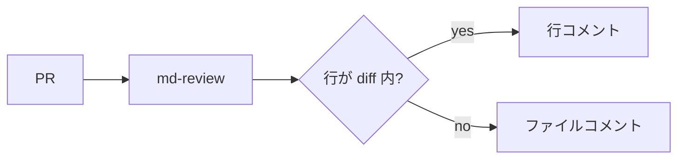

# GFM 表示確認

md-review の試作で、GitHub Flavored Markdown の各書式がプレビューで正しく見えるかを確認するためのファイル。**太字**、*斜体*、~~取り消し線~~、`inline code`、[リンク](https://github.com)、自動リンク https://zenn.dev 、絵文字 :rocket: :tada:。

## 見出しレベル 2

### 見出しレベル 3

#### 見出しレベル 4

## リスト

- 箇条書き 1
- 箇条書き 2
  - ネストした項目
  - もう 1 つ
- 箇条書き 3

1. 番号付き 1
2. 番号付き 2
3. 番号付き 3

## タスクリスト

- [x] 完了したタスク
- [ ] 未完了のタスク
- [ ] もう 1 つの未完了タスク

## 表

| 機能 | 対応 | 備考 |
| :--- | :---: | ---: |
| 表 | ✅ | 左・中央・右寄せ |
| タスクリスト | ✅ | チェックボックス |
| 脚注 | ✅ | 下部に集約 |

## 引用とアラート

> 普通の引用。
> 2 行目。

> [!NOTE]
> 補足のアラート。

> [!TIP]
> ヒントのアラート。

> [!IMPORTANT]
> 重要のアラート。

> [!WARNING]
> 警告のアラート。

> [!CAUTION]
> 注意のアラート。

## コードブロック

```go
package main

import "fmt"

func main() {
	fmt.Println("hello, md-review")
}
```

```diff
- old line
+ new line
```

## Mermaid



## 数式

インライン数式 $E = mc^2$ と、ブロック数式:

$$
\sum_{i=1}^{n} i = \frac{n(n+1)}{2}
$$

## 脚注

本文に脚注を付ける[^1]。もう 1 つ[^note]。

[^1]: 1 つめの脚注。
[^note]: 名前付きの脚注。

## HTML

<details>
<summary>折りたたみ</summary>

中身の **Markdown** も描画される。

</details>

キーボード <kbd>Cmd</kbd> + <kbd>K</kbd>、上付き H<sub>2</sub>O、x<sup>2</sup>。

---

水平線の後の最後の段落。
